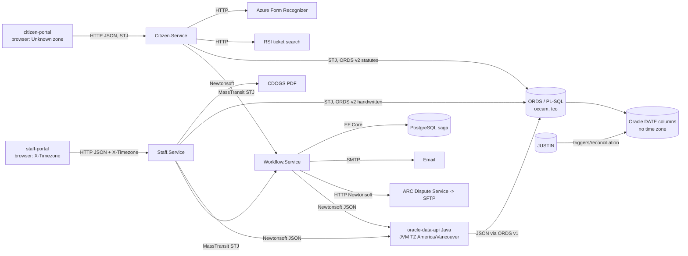

# Datetime Documentation

This folder traces every business datetime used by Traffic Courts Online. Each trace runs from the front-end, or from the process that creates the value, to the Oracle database or external service that stores or consumes it. The goal is to:

- confirm whether the current time zone behaviour is correct
- show where time zones are converted or stored incorrectly
- find ways to simplify the time zone logic

## Assumptions

- All servers and databases run in `America/Vancouver`.
  - The Java service sets this in [Dockerfile](../../src/backend/oracle-data-api/Dockerfile#L72) with `ENV TZ=America/Vancouver`.
  - The .NET services and the web containers get it from Helm, for example [staff-api deployment](../../gitops/charts/traffic-court-online/charts/staff-api/templates/deployment.yaml#L50).
- Citizen-portal users may be in any time zone. Their browser zone is **unknown**.
- Staff-portal users are in `America/Vancouver` or `America/Edmonton`. The browser sends this zone in the `X-Timezone` header ([timezone.interceptor.ts](../../src/frontend/staff-portal/src/app/core/interceptors/timezone.interceptor.ts#L8)).
- `ENT_DTM` and `UPD_DTM` audit columns are ignored. The exception is where the UI shows them as business data, such as file history or remark times. Those cases are marked **audit-derived**.
- `database/*/definitions` are symlinks to sibling SVN checkouts. See [create-definitions-symlinks.sh](../../database/create-definitions-symlinks.sh).

## Time Zone Categories

Every stage table records the zone of the value when it **enters** and **leaves** that stage. The categories are:

| Category | Meaning |
|---|---|
| **UTC** | The value is a UTC wall-clock time or instant. |
| **Local** | The value is an `America/Vancouver` wall-clock time. |
| **Local (X-Timezone)** | The value is in the staff user's zone from `X-Timezone`, either Vancouver or Edmonton. This is a variant of Local. |
| **Unknown** | The zone cannot be determined from the value or from the code. |
| **Date-only** | The value is a calendar date. No time zone applies. |

Almost every hop sends datetimes **without an offset or `Z`**. Examples are `2026-10-28T14:35:00` and Oracle `DATE`. .NET `DateTime.Kind` is almost always `Unspecified`. So the category describes what the digits *mean* by convention, not what the wire format says. When the wire format disagrees with the meaning, the trace notes it.

## Files

| File | Contents |
|---|---|
| [serialization-boundaries.md](serialization-boundaries.md) | How each hop serializes, parses, and converts datetimes. Read this first. All other files rely on it. |
| [occam-dispute-datetimes.md](occam-dispute-datetimes.md) | Ticket issued date/time, dispute submitted timestamp, birthdate, filing date, staff assignment, and dispute-level appearance and violation dates |
| [occam-history-datetimes.md](occam-history-datetimes.md) | Email sent timestamp, update-request status timestamp, update-request submitted date, file history |
| [tco-jj-dispute-datetimes.md](tco-jj-dispute-datetimes.md) | JJ dispute dates: submitted, JJ decision, VTC assignment, violation, ICBC received, fine and revised due dates, latest plea update, decision made, remarks, court appearance and no-appearance times, amendments |
| [external-services-datetimes.md](external-services-datetimes.md) | RSI ticket search, Azure OCR, ARC, email (SMTP), email-verification saga (PostgreSQL), CDOGS printing, COMS, Redis locks, JUSTIN interfaces |
| [filters-and-current-time.md](filters-and-current-time.md) | Date range filters, ticket and dispute search by time, scheduled unassignment, and every "now" or "today" calculation |
| [issues.md](issues.md) | Incorrect conversions or storage found by this trace, plus ways to simplify |

## End-to-End Hops

## Summary of Every Business Datetime

Abbreviations: **OCCAM** = `occam` schema, **TCO** = `tco` schema. Issue IDs refer to [issues.md](issues.md).

| Datetime | Database column(s) / sink | Stored as | Created by | Converted on read by | Status |
|---|---|---|---|---|---|
| Ticket issued date/time | `OCCAM_DISPUTES.ISSUED_DT`, `OCCAM_VIOLATION_TICKET_UPLOADS.ISSUED_DT` | Local | RSI lookup or OCR (citizen); manual entry or edit (staff) | Nothing | Correct. The value is typed as Unknown on every hop. See [I-12](issues.md#i-12) |
| Dispute submitted | `OCCAM_DISPUTES.SUBMITTED_DT`, copied to `TCO_DISPUTES.SUBMITTED_DT` | UTC | Citizen.Service clock (UTC); staff manual entry (Local (X-Timezone) → UTC) | Staff.Service `UtcToLocalTime` | **[I-1](issues.md#i-1), [I-2](issues.md#i-2), [I-3](issues.md#i-3), [I-9](issues.md#i-9)** |
| Disputant birthdate | `OCCAM_DISPUTES.DISPUTANT_BIRTH_DT`, `OCCAM_VIOLATION_TICKET_UPLOADS.DISPUTANT_BIRTH_DT`, JUSTIN `PROF_BIRTH_DT` | Date-only | Nothing sets a real value. Staff hard-codes `2001-01-01` | Nothing | Correct (date-only). [I-13](issues.md#i-13) |
| Filing date | `OCCAM_DISPUTES.FILING_DT` | Date-only | Passed through unchanged on updates only | Nothing | Correct |
| Staff (VTC) assignment, OCCAM | `OCCAM_DISPUTES.USER_ASSIGNED_DTM` | Local (`SYSDATE`) | Database on assign | Nothing | Correct. [I-8](issues.md#i-8) for Edmonton display |
| VTC assignment, TCO | `TCO_DISPUTES.VTC_ASSIGNED_DTM` | UTC (`SYS_EXTRACT_UTC`) | Database on assign | Staff.Service `UtcToLocalTime` | **[I-4](issues.md#i-4)** |
| JJ decision date | `TCO_DISPUTES.JJ_DECISION_DT` | UTC (`SYS_EXTRACT_UTC`) | Database when status changes to CONF or REQH | Staff.Service `UtcToLocalTime` | **[I-5](issues.md#i-5)**, [I-3](issues.md#i-3), [I-14](issues.md#i-14) |
| Violation (offence) date | `TCO_DISPUTES.VIOLATION_DT`, JUSTIN `MATT_OFFENCE_DT` | Date-only | JUSTIN reconciliation | Nothing | Correct. [I-13](issues.md#i-13) |
| ICBC received date | `TCO_DISPUTES.ICBC_RECEIVED_DT` | Local datetime, returned as date-only | JUSTIN `TRANSACTION_DTM` copy | Nothing | Correct |
| Fine due date | `TCO_DISPUTE_COUNTS.FINE_DUE_DT` | Date-only (may keep a time part) | Reconciliation: `MATT_OFFENCE_DT + 30` | Nothing | Correct. [I-16](issues.md#i-16) |
| Revised due date | `TCO_DISPUTE_COUNTS.REVISED_DUE_DT` | Date-only | JJ (date in the browser's zone) | Nothing | Correct |
| Latest plea update | `TCO_DISPUTE_COUNTS.LATEST_PLEA_UPDATE_DTM` | **Mixed** Local and UTC | Java `new Date()` (Local) or Staff.Service `LocalToUtcTime` (UTC) | Staff.Service `UtcToLocalTime` | **[I-6](issues.md#i-6)** |
| Decision made date (count) | Derived from JUSTIN `APPR_TM` | Date-only (Local) | JUSTIN | Nothing | Correct |
| Remark made | `TCO_DISPUTE_REMARKS.REMARKS_MADE_DTM` | Local | Java `new Date()` | Nothing (the UI shows `createdTs`) | Correct. [I-8](issues.md#i-8) |
| Court appearance date/time | JUSTIN `APPR_TM` / `APPR_DT`, `TCO_COURT_APPEARANCES.APPEARANCE_DTM` | Local | JUSTIN | Nothing | Correct. [I-8](issues.md#i-8) |
| Disputant not present (no-app) | `TCO_COURT_APPEARANCES.DISPUTANT_NOT_PRESENT_DTM` | Intended Local | JJ, staff-portal JS `Date` | Nothing | **[I-7](issues.md#i-7)** |
| Amended violation date | `TCO_APPEARANCE_AMENDMENTS.VIOLATION_DATE_DTM` | Date-only | JJ (date in the browser's zone) | Nothing | Correct |
| Email sent / filtered | `OCCAM_OUTGOING_EMAILS.EMAIL_SENT_DTM` | UTC | Workflow.Service clock | Staff.Service `UtcToLocalTime` | [I-3](issues.md#i-3), [I-15](issues.md#i-15) |
| Update-request status timestamp | `OCCAM_DISPUTE_UPDATE_REQUESTS.STATUS_UPDATE_DTM` | Local | Java `new Date()` | Nothing | Correct |
| Update-request submitted (oldest) | `MIN(OCCAM_DISPUTE_UPDATE_REQUESTS.ENT_DTM)` (audit-derived) | Local | Database audit | Nothing | Correct |
| Hearing date (update-request list) | Derived from JUSTIN `APPR_TM` | Date-only (Local) | JUSTIN | Nothing | Correct |
| Dispute filed date sent to JUSTIN | `justin_rest.vt_dispute_post(DisputeFiledDate)` | Date-only, taken from the **UTC** `SUBMITTED_DT` | `justin_tco_interface.ticket_data_insert` | n/a | **[I-10](issues.md#i-10)** |
| ARC transaction date/time | ARC file `TransactionDate` / `TransactionTime` | Local | ARC service clock | n/a | Correct |
| ARC effective / service date | ARC file `EffectiveDate` / `ServiceDate` | Date-only (Local), taken from issued date/time | ARC service | n/a | Correct |
| Email verification checked / verified | PostgreSQL saga `VerifiedAt` (`timestamptz`), message `CheckedAt` | UTC (instant) | Workflow.Service clock | n/a | Correct |
| Dispute lock created / expires | Redis hash, `LockExpiresAtUtc` | UTC (with offset) | Staff.Service clock | n/a | Correct |
| Statute effective-on filter | JUSTIN `STAT_EFFECTIVE_DT` / `STAT_TERMINATION_DT` | Date-only | Server `DateTime.Today` (Local) | n/a | Correct |
| Ticket search time (`HH:mm`) | Compared with `TO_CHAR(ISSUED_DT,'HH24:MI')` | Local | User input or the ticket | n/a | Correct. [I-11](issues.md#i-11) (docs say UTC) |
